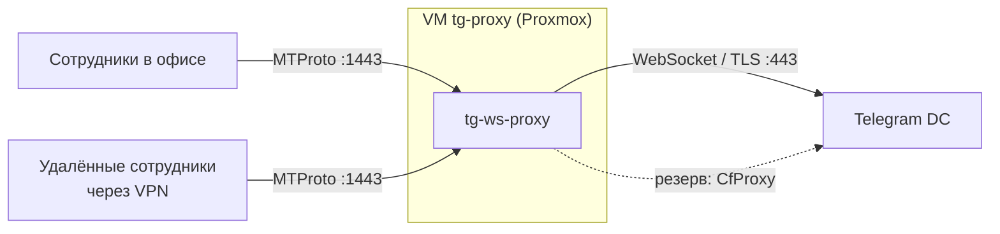

# TG WS Proxy Corp (Proxmox VM)

**Автор:** Cybermind · **Лицензия:** MIT · **Версия:** 1.1.0

Развёртывание **единого корпоративного Telegram-прокси** на базе
[**tg-ws-proxy**](https://github.com/Flowseal/tg-ws-proxy) (автор — [Flowseal](https://github.com/Flowseal))
в отдельной виртуальной машине Proxmox VE — одной командой.

Сотрудники в офисе и удалённые сотрудники, подключённые по VPN, используют один
MTProto-прокси внутри сети предприятия. Прокси выходит к Telegram через WebSocket
(TLS, порт 443), а при недоступности WebSocket — через резервный путь CfProxy.

> **Авторство.** Скрипты развёртывания — **Cybermind**. Сам прокси — проект **tg-ws-proxy** © Flowseal, лицензия MIT.
> Этот репозиторий содержит только скрипты развёртывания и обслуживания; код
> tg-ws-proxy при установке скачивается из
> [оригинального репозитория](https://github.com/Flowseal/tg-ws-proxy) и здесь
> не распространяется. Вопросы о работе самого прокси — к оригинальному проекту.

---

## Содержание

- [Как это работает](#как-это-работает)
- [Состав репозитория](#состав-репозитория)
- [Требования](#требования)
- [Быстрый старт (Proxmox)](#быстрый-старт-proxmox)
- [Установка на существующий сервер (без Proxmox)](#установка-на-существующий-сервер-без-proxmox)
- [Параметры pve-create-tg-proxy.sh](#параметры-pve-create-tg-proxysh)
- [Параметры и команды tg-ws-proxyctl](#параметры-и-команды-tg-ws-proxyctl)
- [Подключение сотрудников](#подключение-сотрудников)
- [Обслуживание](#обслуживание)
- [Обновление](#обновление)
- [Безопасность](#безопасность)
- [Решение проблем](#решение-проблем)
- [Удаление](#удаление)
- [Лицензия и благодарности](#лицензия-и-благодарности)

---

## Как это работает



1. Клиент Telegram подключается к прокси по протоколу MTProto с секретом из ссылки.
2. tg-ws-proxy определяет нужный дата-центр Telegram и открывает к нему
   WebSocket-соединение по TLS через домены Telegram — для сети это обычный HTTPS.
3. Если WebSocket недоступен, прокси переключается на резервный путь (CfProxy).

Прокси передаёт **только трафик Telegram**. Это не универсальный SOCKS/HTTP-прокси.

---

## Состав репозитория

| Файл | Где запускать | Назначение |
|---|---|---|
| `pve-create-tg-proxy.sh` | нода Proxmox VE | Создаёт VM на Debian через cloud-init и автоматически ставит в неё прокси |
| `tg-ws-proxyctl.sh` | VM / любой Linux-сервер | Установщик и утилита управления: установка, обновление, статус, ссылка, смена секрета, удаление |
| `README.md` | — | Эта инструкция |
| `CHANGELOG.md` | — | История изменений |
| `LICENSE` | — | Лицензия MIT (на скрипты этого репозитория) |

`pve-create-tg-proxy.sh` берёт `tg-ws-proxyctl.sh` из той же папки и передаёт его
в VM, поэтому держите оба файла рядом.

---

## Требования

**Нода Proxmox VE**
- Proxmox VE 7.2+ (рекомендуется 8.x).
- Доступ ноды к `cloud.debian.org` по HTTPS (скачивание образа Debian).
- Хранилище с типом содержимого **snippets** — для автоматической установки
  (см. [подготовку](#1-подготовьте-хранилище-snippets)).

**Виртуальная машина** (создаётся скриптом)
- 1 vCPU, 1 ГБ RAM, диск 8 ГБ — достаточно для офиса на десятки–сотни пользователей.
- Исходящий доступ в интернет по **443/TCP** (GitHub, PyPI, Telegram, Cloudflare).
- Входящий **1443/TCP** из подсетей офиса и VPN.
- Постоянный IP и DNS-запись, например `tg-proxy.corp.local`.

> Не размещайте прокси на серверах, чувствительных к задержкам (например, телефонии):
> всплески трафика при загрузке медиа могут влиять на соседние сервисы.
> Отдельная небольшая VM — оптимальный вариант.

---

## Быстрый старт (Proxmox)

### 1. Подготовьте хранилище snippets

Посмотрите, какие типы содержимого уже включены у хранилища `local`:

```bash
grep -A4 '^dir: local' /etc/pve/storage.cfg
```

Добавьте `snippets`, **перечислив все текущие типы** (иначе они отключатся):

```bash
pvesm set local --content iso,vztmpl,backup,snippets
```

### 2. Скачайте скрипты на ноду

```bash
cd /root
git clone https://github.com/cybermind-off/tg-ws-proxy-corp.git
cd tg-ws-proxy-corp
chmod +x *.sh
```

### 3. Заведите DNS-запись

Например, `tg-proxy.corp.local` → IP будущей VM. Это имя попадёт в ссылку для сотрудников.

### 4. Создайте VM

```bash
./pve-create-tg-proxy.sh \
    --ip 192.168.1.28/24 --gw 192.168.1.1 \
    --dns 192.168.1.2 --searchdomain corp.local \
    --ssh-key /root/.ssh/id_ed25519.pub \
    --public-host tg-proxy.corp.local \
    --allow 192.168.1.0/24,10.20.0.0/24 \
    --firewall ufw
```

Здесь `192.168.1.0/24` — офисная сеть, `10.20.0.0/24` — пул адресов VPN.

Скрипт:
1. скачает облачный образ Debian 13 и проверит его контрольную сумму;
2. создаст VM (1 vCPU, 1 ГБ, 8 ГБ, автозапуск с нодой, guest agent);
3. настроит сеть, пользователя `admin` с SSH-ключом и sudo, часовой пояс,
   автоматические обновления безопасности;
4. при первой загрузке установит tg-ws-proxy;
5. дождётся окончания установки (обычно 3–7 минут), показывая её ход, и выведет
   ссылку для сотрудников.

Пример результата:

```
==> Готово
Ссылка для сотрудников:
  tg://proxy?server=tg-proxy.corp.local&port=1443&secret=dd0123456789abcdef...
  https://t.me/proxy?server=tg-proxy.corp.local&port=1443&secret=dd0123456789abcdef...

VM:       123 (tg-proxy)
Адрес:    192.168.1.28
SSH:      ssh admin@192.168.1.28
Прокси:   sudo tg-ws-proxyctl status
```

Если установка внутри VM завершилась ошибкой, скрипт покажет хвосты логов и
**оставит VM для диагностики** (см. [Решение проблем](#решение-проблем)).

---

## Установка на существующий сервер (без Proxmox)

Подойдёт любой Debian 11+/Ubuntu 20.04+ или RHEL/Alma/Rocky 9+ с Python 3.8+.

```bash
sudo bash tg-ws-proxyctl.sh install \
     --public-host tg-proxy.corp.local \
     --allow 192.168.1.0/24,10.20.0.0/24 \
     --firewall ufw
```

После установки скрипт доступен как команда `tg-ws-proxyctl`.

Если сервер выходит в интернет через корпоративный HTTP-прокси или PyPI-зеркало:

```bash
export HTTPS_PROXY=http://proxy.corp.local:3128
export PIP_INDEX_URL=https://pypi.corp.local/simple
sudo -E bash tg-ws-proxyctl.sh install --repo https://git.corp.local/mirror/tg-ws-proxy.git ...
```

---

## Параметры pve-create-tg-proxy.sh

**Виртуальная машина**

| Параметр | По умолчанию | Описание |
|---|---|---|
| `--vmid N` | следующий свободный | ID VM |
| `--name NAME` | `tg-proxy` | Имя VM (и hostname) |
| `--cores N` | `1` | Количество vCPU |
| `--memory MB` | `1024` | Память, МБ |
| `--disk SIZE` | `8G` | Размер диска |
| `--storage ID` | `local-lvm` | Хранилище для диска |
| `--bridge IF` | `vmbr0` | Сетевой мост |
| `--vlan TAG` | — | VLAN-тег |
| `--debian 12\|13` | `13` | Версия Debian |
| `--timezone TZ` | `Europe/Moscow` | Часовой пояс |

**Сеть и доступ**

| Параметр | По умолчанию | Описание |
|---|---|---|
| `--ip CIDR\|dhcp` | `dhcp` | Адрес VM, например `192.168.1.28/24` |
| `--gw IP` | — | Шлюз (обязателен для статического адреса) |
| `--dns "IP [IP]"` | — | DNS-серверы |
| `--searchdomain DOM` | — | DNS-домен, например `corp.local` |
| `--user NAME` | `admin` | Пользователь для входа (sudo без пароля) |
| `--ssh-key FILE` | — | Публичный SSH-ключ (рекомендуется) |
| `--password` | — | Запросить пароль пользователя интерактивно |

Нужно указать `--ssh-key` или `--password`, иначе войти в VM будет нельзя.

**Установка прокси**

| Параметр | По умолчанию | Описание |
|---|---|---|
| `--public-host HOST` | `NAME.searchdomain` или IP | Имя/адрес в ссылке для сотрудников |
| `--allow NETS` | — | Подсети офиса и VPN через запятую |
| `--firewall MODE` | `auto` | `ufw` — включить ufw в VM и открыть 1443 только для `--allow`; `auto` — использовать уже включённый файрвол; `none` — не трогать |
| `--pool-size N` | `4` | WebSocket-пул на каждый DC |
| `--proxyctl FILE` | `tg-ws-proxyctl.sh` рядом | Путь к установщику |
| `--no-install` | — | Создать VM без установки прокси |
| `--updates MODE` | `auto` | Обновления tg-ws-proxy: `auto` — ежедневно ставить, `check` — только проверять, `off` — выключить |
| `--update-time HH:MM` | `04:30` | Время ежедневного обновления |
| `--snippet-storage ID` | автоопределение | Хранилище snippets |

**Прочее**

| Параметр | Описание |
|---|---|
| `--no-start` | Только создать VM, не запускать |
| `--no-wait` | Не ждать окончания установки |
| `--refresh-image` | Перекачать образ Debian |
| `--version` | Версия скрипта |
| `-h`, `--help` | Справка |

---

## Параметры и команды tg-ws-proxyctl

### Команды

| Команда | Описание |
|---|---|
| `install` | Установить или переустановить (секрет и настройки сохраняются) |
| `apply` | Применить новые параметры (флаги ниже или правка конфига) |
| `update` | Обновить tg-ws-proxy до последнего релиза, с автооткатом при сбое |
| `check` | Проверить наличие новой версии (код выхода `10` — есть обновление) |
| `auto-update` | Проверить и, в режиме `auto`, установить (это запускает ежедневный таймер) |
| `status` | Состояние службы, версия, ссылка, последние записи лога |
| `link` | Показать ссылку для сотрудников и QR-код |
| `rotate-secret` | Сгенерировать новый секрет (старая ссылка перестанет работать) |
| `version` | Версии скрипта и установленного tg-ws-proxy |
| `uninstall [--purge]` | Удалить (с `--purge` — вместе с конфигом и логами) |

### Параметры (для `install` и `apply`)

| Параметр | По умолчанию | Описание |
|---|---|---|
| `--public-host HOST` | `hostname -f` | Имя/адрес в ссылке для сотрудников |
| `--listen ADDR` | `0.0.0.0` | Адрес прослушивания |
| `--port N` | `1443` | Порт |
| `--allow NETS` | — | Подсети, которым разрешён доступ |
| `--firewall MODE` | `auto` | `auto` \| `ufw` \| `firewalld` \| `none` |
| `--pool-size N` | `8` | WebSocket-пул на DC (при установке через Proxmox — `4`) |
| `--dc-ips "LIST"` | `2:149.154.167.220 4:149.154.167.220` | Пары `DC:IP` через пробел |
| `--extra-args "ARGS"` | — | Дополнительные аргументы tg-ws-proxy, например `--proxy-protocol` |
| `--version TAG` | `latest` | Версия tg-ws-proxy (тег релиза) |
| `--repo URL` | репозиторий Flowseal | Git-репозиторий (можно внутреннее зеркало) |
| `--secret HEX32` | генерируется | Задать секрет вручную (32 hex-символа) |
| `--updates MODE` | `auto` | `auto` — ежедневно проверять и ставить; `check` — только проверять; `off` — выключить |
| `--update-time HH:MM` | `04:30` | Время ежедневного запуска |
| `--update-delay N` | `0` | Ставить релиз не раньше чем через N дней после выхода |
| `--no-timer` | — | То же, что `--updates off` |

Примеры:

```bash
sudo tg-ws-proxyctl apply --allow 192.168.1.0/24,10.20.0.0/24,10.30.0.0/24
sudo tg-ws-proxyctl apply --pool-size 8
sudo tg-ws-proxyctl apply --extra-args "--proxy-protocol"     # за HAProxy
```

---

## Подключение сотрудников

Ссылку показывает команда `sudo tg-ws-proxyctl link`, она также сохранена в
`/etc/tg-ws-proxy/link.txt`. Если установлен `qrencode`, рядом лежит QR-код
`/etc/tg-ws-proxy/link-qr.png`.

Разошлите ссылку `https://t.me/proxy?...` (или QR-код) — она открывается на
компьютере и телефоне.

**Telegram Desktop:** открыть ссылку → «Подключить». Вручную:
*Настройки → Продвинутые настройки → Тип подключения → Прокси → Добавить → MTProto*,
сервер `tg-proxy.corp.local`, порт `1443`, секрет из ссылки (вместе с префиксом `dd`).

**Android / iOS:** открыть ссылку → «Подключить прокси». Управление:
*Настройки → Данные и память → Прокси*.

**Удалённые сотрудники.** Прокси доступен только при подключённом VPN. Без VPN
Telegram сам на прямое соединение не переключится — прокси в клиенте нужно
выключить вручную (на телефоне это особенно актуально). При split tunneling
добавьте адрес прокси в маршруты, идущие через VPN.

---

## Обслуживание

```bash
sudo tg-ws-proxyctl status                     # общее состояние
sudo tail -f /var/log/tg-ws-proxy/proxy.log    # лог прокси (статистика раз в минуту)
journalctl -u tg-ws-proxy -f                   # журнал службы
```

С ноды Proxmox без SSH (через guest agent):

```bash
qm guest exec <VMID> --timeout 60 -- tg-ws-proxyctl status
```

### Файлы и пути

| Путь | Содержимое |
|---|---|
| `/etc/tg-ws-proxy/config` | Конфигурация (включая секрет, права 600) |
| `/etc/tg-ws-proxy/link.txt` | Ссылка для сотрудников |
| `/etc/tg-ws-proxy/link-qr.png` | QR-код ссылки |
| `/opt/tg-ws-proxy/src` | Исходники tg-ws-proxy (git, на теге релиза) |
| `/opt/tg-ws-proxy/venv` | Виртуальное окружение Python |
| `/var/log/tg-ws-proxy/proxy.log` | Лог прокси (ротация: 5 файлов по 20 МБ) |
| `/etc/systemd/system/tg-ws-proxy.service` | Служба (генерируется, вручную не править) |
| `/etc/systemd/system/tg-ws-proxy-update.timer` | Ежедневный таймер обновлений |
| `/usr/local/sbin/tg-ws-proxyctl` | Утилита управления |
| `/var/log/tg-ws-proxy-install.log` | Лог автоустановки (VM из Proxmox) |

Служба работает от отдельного системного пользователя `tgproxy` с ограничениями
systemd (read-only файловая система, без повышения привилегий).

---

## Обновление

### tg-ws-proxy: автоматически

По умолчанию прокси **обновляется сам**: каждый день в **04:30** (± до 15 минут)
таймер проверяет релизы оригинального проекта и, если вышла новая версия,
устанавливает её. Если после обновления служба не поднялась, выполняется
автоматический откат на предыдущую версию. Секрет и ссылка не меняются.

При перезапуске текущие соединения обрываются, клиенты переподключаются за
несколько секунд, поэтому время по умолчанию — ночное.

Режим, время и задержка настраиваются:

```bash
sudo tg-ws-proxyctl apply --updates auto                 # ежедневно ставить (по умолчанию)
sudo tg-ws-proxyctl apply --updates check                # только проверять и писать в журнал
sudo tg-ws-proxyctl apply --updates off                  # не проверять
sudo tg-ws-proxyctl apply --update-time 03:00            # другое время
sudo tg-ws-proxyctl apply --update-delay 2               # ставить релиз не раньше чем через 2 дня после выхода
```

`--update-delay` защищает от неудачных свежих релизов: если в новой версии
найдут ошибку, у автора будет время выпустить исправление до того, как
обновление дойдёт до вас.

Текущий режим и время следующего запуска показывает `sudo tg-ws-proxyctl status`.
Журнал обновлений:

```bash
journalctl -u tg-ws-proxy-update -n 30          # что делал таймер
journalctl -t tg-ws-proxy -n 20                 # итоги: обновлено / откат / есть новая версия
systemctl list-timers tg-ws-proxy-update.timer  # когда следующий запуск
```

Запустить автообновление вручную, не дожидаясь таймера:

```bash
sudo systemctl start tg-ws-proxy-update.service
```

### tg-ws-proxy: вручную

```bash
sudo tg-ws-proxyctl check     # есть ли новая версия + ссылка на список изменений
sudo tg-ws-proxyctl update    # обновить сейчас
```

С ноды Proxmox:

```bash
qm guest exec <VMID> --timeout 300 -- tg-ws-proxyctl update
```

**Закрепить версию** (автообновление перестанет её менять) и снять закрепление:

```bash
git -C /opt/tg-ws-proxy/src tag --sort=-v:refname | head   # список версий
sudo tg-ws-proxyctl apply --version v1.12.0 && sudo tg-ws-proxyctl update
sudo tg-ws-proxyctl apply --version latest  && sudo tg-ws-proxyctl update
```

Также можно подписаться на релизы оригинального проекта на GitHub:
*Watch → Custom → Releases* в репозитории
[Flowseal/tg-ws-proxy](https://github.com/Flowseal/tg-ws-proxy).

### Скрипты этого репозитория

```bash
# на ноде
cd /root/tg-ws-proxy-corp && git pull

# на VM: скопировать новый установщик и переустановить (настройки сохранятся)
scp tg-ws-proxyctl.sh admin@<IP_VM>:/tmp/
ssh admin@<IP_VM> 'sudo bash /tmp/tg-ws-proxyctl.sh install'
```

### Операционная система

В VM, созданной из Proxmox, включены автоматические обновления безопасности
(`unattended-upgrades`).

---

## Безопасность

- **Доступ к прокси защищён только секретом.** Логинов нет, поэтому обязательно
  ограничьте порт 1443 подсетями офиса и VPN: `--allow` + `--firewall ufw`
  или правилами на сетевом оборудовании.
- **Автообновление** ставит релизы оригинального проекта без ручной проверки.
  Если нужен контроль над тем, что попадает на сервер, используйте
  `--updates check` (обновлять вручную после просмотра изменений) или
  `--update-delay N`.
- **Секрет утёк** — `sudo tg-ws-proxyctl rotate-secret` и разошлите новую ссылку.
- Прокси не расшифровывает переписку: трафик Telegram остаётся зашифрованным.
- Секрет передаётся процессу в аргументах командной строки, поэтому виден
  локальным пользователям VM в `ps`. Не давайте посторонним доступ к VM.
- Режим `--firewall ufw` оставляет SSH (22/tcp) открытым для всех адресов.
  При необходимости сузьте: `sudo ufw delete allow 22/tcp && sudo ufw allow from 192.168.1.0/24 to any port 22 proto tcp`.

---

## Решение проблем

### Не грузятся фото и видео

Известная особенность tg-ws-proxy, в основном у аккаунтов без Premium. Оригинальный
проект рекомендует оставить в списке DC только `4:149.154.167.220`:

```bash
sudo tg-ws-proxyctl apply --dc-ips "4:149.154.167.220"
```

Подробнее — в [README tg-ws-proxy](https://github.com/Flowseal/tg-ws-proxy).

### Предупреждение «прямое соединение с 149.154.167.220:443 не проходит»

Провайдер или файрвол блокируют прямой доступ к адресам Telegram. Это ожидаемо:
прокси использует WebSocket через домены Telegram и резервный путь CfProxy.
Проверьте работу реальным клиентом и посмотрите лог
`/var/log/tg-ws-proxy/proxy.log`.

### Скрипт создания VM долго ждёт или сообщает об ошибке установки

Зайдите в VM и посмотрите логи:

```bash
ssh admin@<IP_VM>
sudo tail -n 40 /var/log/tg-ws-proxy-install.log
sudo cloud-init status --long
sudo tail -n 30 /var/log/cloud-init-output.log
```

Типичные причины:
- **Нет выхода в интернет** (GitHub, PyPI) — откройте VM исходящий 443/TCP.
- **Ошибка в логе установки** — исправьте причину и перезапустите установку
  в VM: `sudo bash /root/tg-ws-proxyctl.sh install` (параметры возьмутся из
  сохранённого конфига, если установка дошла до его записи).

### «QEMU guest agent is not running»

Агент запускается при первой загрузке после установки пакетов. Если VM уже
работает, перезапустите его в VM: `sudo systemctl restart qemu-guest-agent`.

### «уже выполняется другой экземпляр tg-ws-proxyctl»

Предыдущий запуск ещё работает (например, SSH-сессия прервана, а процесс остался).
Остановите его:

```bash
sudo pkill -f "tg-ws-proxyctl[.]sh install"
```

### Нет хранилища snippets

См. [подготовку](#1-подготовьте-хранилище-snippets) или создайте VM без
автоустановки (`--no-install`) и установите прокси вручную через `tg-ws-proxyctl.sh`.

### `bash: ...\r: command not found`

Файл скрипта сохранён с окончаниями строк Windows (CRLF). Скачивайте через
`git clone` (в репозитории задан `.gitattributes` с `eol=lf`) либо исправьте:
`sed -i 's/\r$//' *.sh`.

### Служба не запускается

```bash
journalctl -u tg-ws-proxy -n 50 --no-pager
sudo tg-ws-proxyctl version
```

---

## Удаление

Внутри VM:

```bash
sudo tg-ws-proxyctl uninstall           # конфиг и логи сохраняются
sudo tg-ws-proxyctl uninstall --purge   # удалить всё
```

VM целиком, на ноде Proxmox:

```bash
qm stop <VMID>; qm destroy <VMID> --purge
rm -f /var/lib/vz/snippets/tg-proxy-<VMID>-vendor.yaml
```

---

## Лицензия и благодарности

- **tg-ws-proxy** — © [Flowseal](https://github.com/Flowseal), лицензия MIT,
  <https://github.com/Flowseal/tg-ws-proxy>. Вся функциональность прокси —
  заслуга оригинального проекта.
- **TG WS Proxy Corp** — скрипты этого репозитория (`pve-create-tg-proxy.sh`,
  `tg-ws-proxyctl.sh`) и документация, © Cybermind, лицензия MIT, см. [LICENSE](LICENSE).

Проект не связан с Telegram и не является официальной частью tg-ws-proxy.
Используйте его в соответствии с политиками вашей организации и применимым
законодательством.
